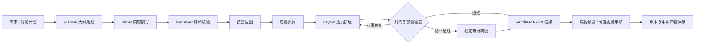

# 多智能体 PPT 生成系统

基于多角色智能体协作的本地 PowerPoint 生成与迭代工作台。用户输入主题和要求，系统完成大纲规划、内容撰写、按需配图、逐页排版与审核，输出 PPTX，并保存可追溯的中间产物。支持指定页面修改、设计候选比较，以及围绕已保存文稿进行带页码引用的内容问答。

提供 **Windows 桌面窗口**和**本机 Web 工作台**两种入口。程序、任务队列与历史数据运行在本机；配置模型服务后，文本、配图及可选视觉审核请求会调用外部 API。本地版不等同于完全离线的大模型服务。

**技术栈：** Python 3.12、Flask、pywebview、Pydantic、python-pptx、OpenAI SDK、DashScope、SQLite、Huey、CairoSVG、LibreOffice、Poppler、Windows DPAPI（pywin32）。

## 核心功能

| 功能 | 说明 |
| --- | --- |
| 多阶段生成流水线 | 大纲规划 → 内容撰写 → 结构校验 → 按需配图 → 逐页排版 → PPTX 渲染；按配置执行成品预览与视觉审核 |
| 双层 Schema | Pydantic 分离语义大纲与物理画布，通过稳定 ID 和 `content_ref` 绑定文本、数值及组件，减少排版阶段改写内容 |
| 页面级增量修改 | 支持单页、多页、范围及全文修改；其余页面沿用已有内容与布局，避免全量重生成 |
| 文本与设计分离 | 仅改文本时锁定物理布局；仅改设计时锁定文字与数值，调整构图、配色等表现形式 |
| 容量预算与冲突闭环 | 排版前估算可用容量，排版后检查约束，将结构化错误反馈给 Layout 进行有限重排；仍失败时尝试稳定布局 |
| 表格、图示与图标 | 原生可编辑表格、图示节点与连接线；复杂图支持 SVG 并保比例放置，内置 Lucide 图标库 |
| 成品预览与审核 | LibreOffice / Poppler 将 PPTX 转成 PDF 与逐页 PNG；可选视觉理解模型审核，最多两轮修复 |
| 设计候选 | 基于已保存版本尝试两个构图方向，比较后选择采用；只有通过内容与排版约束的候选可用 |
| 需求讨论与内容问答 | 讨论形成可应用的生成或修改计划；问答读取已保存版本，返回页码、引用与原文证据 |
| 历史记忆与版本 | SQLite 持久化会话、用户消息、任务、版本及资产索引；超出输入预算时按规则摘录历史，保留原始消息 |
| 持久队列与阶段缓存 | 独立 Huey worker 消费任务；按输入、提示词与模型等信息复用阶段结果，外部调用结果不明时不盲目重试 |
| 归档与备份恢复 | 按版本下载 PPTX、大纲和排版蓝图；旧归档显式导入；完整运行目录支持哈希校验后的备份与独立恢复 |

默认生成 **2–5 页**，可指定总页数或范围，支持 1–50 页（包含封面）。范围表示页数约束，并不保证任意长度内容都能在该范围内排下。

## 系统架构



Planner、Writer、Layout 等角色通过模型完成规划；结构校验、内容锁定、几何与容量检查、文件导出由代码执行。视觉审核发生在成品渲染后，不能与渲染前的代码检查混为一谈。

稳定布局仍需通过约束校验。内容、页数与字号等要求确实无法兼容时，系统明确失败，不通过静默截断正文或擅自扩页伪造成功。

## 项目结构

```text
.
├── launcher.py               # Windows 桌面入口，同时管理本机 Web / worker
├── app.py                    # Flask 工作台、会话与 API
├── main.py                   # 全量生成、增量修改与排版修复主控
├── worker.py                 # 持久队列消费、归档扫描、备份与恢复
├── renderer.py               # PPTX 渲染、组件几何与容量检查
├── config_manager.py         # 密钥配置、Cairo 与输出路径管理
├── agents/
│   ├── planner.py            # 大纲规划
│   ├── writer.py             # 内容撰写
│   ├── review.py             # 大纲与组件结构校验
│   ├── image_generator.py    # 按需配图
│   ├── template.py           # 逐页排版
│   ├── dialogue.py           # 需求讨论与文稿问答
│   └── visual_review.py      # 成品视觉审核
├── config/
│   ├── schema.py             # 语义层与物理层数据模型
│   ├── content.py            # 页数、稳定引用、内容回填与布局锁
│   ├── layout_budget.py      # 容量预算与约束反馈
│   ├── layout_fallback.py    # 稳定布局降级
│   ├── design.py             # 设计候选与采用
│   ├── storage.py            # SQLite 会话、任务、版本与资产库
│   ├── jobs.py               # Huey 调度、阶段缓存与任务执行
│   ├── context.py            # 输入预算与可追溯历史摘录
│   ├── preview.py            # PPTX → PDF / PNG
│   ├── visual.py             # 成品审核与修复闭环
│   ├── archives.py           # 旧归档导入、备份与恢复
│   └── ...                   # 状态、清洗、图标、日志与模型客户端
├── assets/icons/             # SVG 图标及原始许可证
├── templates/                # 工作台与模型设置页面
├── static/                   # 前端样式与交互
├── tests/                    # 核心离线回归测试
├── requirements.txt          # 直接运行依赖
├── requirements-lock.txt     # Web / worker 完整依赖快照
└── requirements-desktop.txt  # Windows 桌面依赖，包含上述锁定依赖
```

运行时生成的 `config/config.json`、`debug_logs/`、`.runtime/` 与虚拟环境不随源码分发。使用者需单独安装系统运行时并配置自己的模型服务。

## 环境要求与安装

建议使用 **Windows x64、Python 3.12**。完整依赖快照基于 Python 3.12；其他版本和系统需要单独验证。SQLite 需支持 JSON 函数与 WAL。

### 1. 安装 Python 依赖

在项目根目录执行（Windows PowerShell）：

```powershell
python -m venv .venv
# 桌面模式，包含 Web / worker 依赖
.venv\Scripts\python.exe -m pip install -r requirements-desktop.txt
```

只使用本机浏览器时，可改为安装 `requirements-lock.txt`，并通过环境变量提供 Key；Windows 页面保存密钥还需要桌面依赖中的 pywin32。`requirements.txt` 记录直接依赖，锁定文件记录完整快照；依赖更新后应在干净环境重新解析并验证。

### 2. 配置渲染与预览工具

| 运行时 | 功能 | 配置方式 |
| --- | --- | --- |
| Cairo 动态库 | SVG 与图标转 PNG，属于渲染依赖 | Windows 自动查找 Python 环境的 `Library/bin` 和 `PATH`，也可设置 `PPT_CAIRO_BIN` 指向 DLL 目录 |
| LibreOffice Impress | 将 PPTX 转成 PDF | 安装后从常见目录或 `PATH` 查找，也可用 `PPT_SOFFICE` 指向可执行文件 |
| Poppler | 检查 PDF 页数并生成逐页 PNG | 将工具加入 `PATH`，或用 `PPT_POPPLER_BIN` 指向含 `pdfinfo`、`pdftoppm` 的目录 |
| 中文字体 | 中文文字和 SVG 标签的正确显示 | 安装支持中文的字体；不同字体和 Office 环境可能影响换行，需查看成品 |

检查运行时，不调用模型：

```powershell
.venv\Scripts\python.exe -X utf8 worker.py --check-runtime
.venv\Scripts\python.exe -X utf8 worker.py --preview-tools
```

缺少 Cairo 会影响 SVG / 图标渲染；缺少 LibreOffice 或 Poppler 时不能完成成品预览和视觉审核。可暂设 `PPT_PREVIEW_ENABLED=0` 跳过预览，但此时不能据此判断成品视觉质量。设计候选功能也依赖预览工具。

## 模型与密钥配置

Windows 首次使用可在模型设置页填写 Key 与可选服务地址。Key 使用 DPAPI 加密保存到 `config/config.json`，密文绑定当前 Windows 账户与机器；换账户、换机器或重装系统后需重新配置。该文件不参与版本控制。

也可通过环境变量配置。文本与视觉请求使用 OpenAI 兼容协议，生图使用 DashScope 原生协议；两个地址分别配置。

| 环境变量 | 用途 |
| --- | --- |
| `DASHSCOPE_API_KEY` | 模型服务 Key，优先于本机保存配置 |
| `DASHSCOPE_BASE_URL` | 文本 / 视觉的兼容接口；留空使用代码中的百炼官方兼容地址 |
| `DASHSCOPE_IMAGE_BASE_URL` | 生图原生 API 地址；留空使用 `https://dashscope.aliyuncs.com/api/v1`，不能填 `/compatible-mode/v1` 地址 |
| `PPT_PLANNER_MODEL` / `PPT_WRITER_MODEL` / `PPT_LAYOUT_MODEL` | 大纲、内容和排版模型 |
| `PPT_DIALOGUE_MODEL` | 讨论与内容问答模型 |
| `PPT_IMAGE_MODEL` / `PPT_VISION_MODEL` | 生图模型 / 视觉理解模型，两种能力分别选择 |
| `PPT_<ROLE>_THINKING` | `auto`、`on` 或 `off`；ROLE 为 PLANNER、WRITER、LAYOUT、DIALOGUE、VISION |
| `PPT_THINKING_BUDGET` | 已支持该参数的 Qwen 思考预算，默认 2048，范围 256–8192 |
| `PPT_VISUAL_REVIEW` | `0` 关闭云端视觉审核，保留预览；默认开启，需确认模型实际支持图片输入 |
| `PPT_PREVIEW_ENABLED` | `0` 关闭成品预览及其后的视觉审核，默认开启 |
| `PPT_OUTPUT_ROOT` | 会话、数据库、资产与日志的统一根目录，默认项目下的 `debug_logs/` |
| `PPT_RENDER_TMP` | 预览转换临时目录，默认项目下的 `.runtime/render-tmp/` |
| `PPT_CONTEXT_INPUT_TOKENS` | 业务输入预算，默认 24000；使用保守估算，并非供应商的精确 tokenizer 计数 |

源码保留开发时的角色模型默认名，不代表所有账户或网关均支持。使用前应将模型名改为自己账户可调用的值；更换模型、地址或 Key 后重启 Web 与 worker。

`auto` 按已识别模型的能力构造参数，不等于始终开启思考。Qwen 的 `auto` 默认关闭思考；已识别的 Kimi / GLM 模型不注入不支持的关闭开关。开启思考仍受输出长度与 Schema 约束，不保证设计质量一定改善。

初次运行可在启动终端先执行 `$env:PPT_VISUAL_REVIEW='0'`，确认视觉模型能力与预算后再启用。模型请求可能产生费用；云端审核会发送页面图片。环境变量仅作用于当前终端及其子进程，手动启动 Web / worker 时需分别配置一致的值。

## 使用方式

### Windows 桌面窗口

```powershell
.venv\Scripts\python.exe -X utf8 launcher.py
```

启动器同时启动本机 Web 与独立 worker，首次未配置 Key 时进入设置页。关闭窗口会停止本次启动的 worker；已排队任务保留在数据库中。

### 本机 Web 工作台

分别打开两个终端，在同一项目目录执行：

```powershell
.venv\Scripts\python.exe -X utf8 app.py
```

```powershell
.venv\Scripts\python.exe -X utf8 worker.py
```

浏览器访问 `http://127.0.0.1:8000`。只启动 Web 时任务会停留在队列，必须同时运行 worker。若配置 `PPT_OUTPUT_ROOT`，两者必须指向同一个绝对路径。

工作台中可新建文稿、填写主题与要求、指定页数；生成后浏览预览并按版本下载 PPTX、大纲与蓝图。讨论页可整理需求并应用计划，提问页读取已保存文稿。修改页码支持 `2`、`2,3`、`2-4`、`1,3-5` 等写法；文本修改保持物理布局，设计修改保留文字和数值。

无 Key 时只能生成基础离线演示，不能替代真实模型质量验证。程序未实现应用账号与多人权限隔离，本机入口保持回环地址监听。

## 运行产物与日志

### 保存位置

默认根目录为项目下的 **`debug_logs/`**，由 `config_manager.get_output_root()` 统一定位。可通过 `PPT_OUTPUT_ROOT` 指定其他目录；不要在 Web 与 worker 之间配置不同位置。

桌面 / Web 每次提交任务会创建一个带随机后缀的时间戳目录。同一会话可以包含多个任务和版本，因此“一个任务目录”不等于“一个完整会话”。以下为按功能汇总的示意，不是每个任务都会生成全部文件：

```text
debug_logs/
├── app.sqlite3                         # 会话、消息、任务、阶段缓存、版本与资产索引
├── queue.sqlite3                       # Huey 持久任务队列
├── worker.log                          # 桌面启动器收集的 worker 输出
└── <YYYYMMDD_HHMMSS>_<随机后缀>/        # 一次生成 / 修改 / 讨论 / 候选任务
    ├── <文件名>.pptx                   # 本次生成或修改的成品
    ├── state.json                      # 本次任务的状态快照
    ├── dialogue.json                   # 讨论 / 问答结果，仅对应任务生成
    ├── run/                            # 生成链中间产物与错误记录
    │   ├── raw_outline_attempt_*.json
    │   ├── compiled_content_attempt_*.json
    │   ├── final_content_passed.json
    │   ├── final_content_with_images.json
    │   ├── slide_accent_*.png
    │   ├── layout_page_<页码>_budget.json
    │   ├── layout_page_<页码>_attempt_*.json
    │   ├── layout_page_<页码>_error_*.json
    │   ├── layout_page_<页码>_resolved.json
    │   ├── layout_page_<页码>_fallback.json
    │   ├── final_blueprint.json
    │   ├── incremental_outline.json
    │   ├── incremental_blueprint.json
    │   └── error.json / error.txt
    └── generated/
        ├── snapshots/<成品文件名去扩展名>/
        │   ├── outline.json            # 已提交版本的语义内容快照
        │   └── blueprint.json          # 已提交版本的物理布局快照
        ├── visual/
        │   ├── review.json             # 视觉审核状态、问题与修复结果
        │   └── previews/<预览哈希>/
        │       ├── deck.pdf
        │       ├── page-1.png ...
        │       └── preview.json
        ├── design/                     # 设计候选任务的结果
        │   ├── candidates.json
        │   ├── baseline/               # 原版预览
        │   └── <候选方向>/             # 候选 PPTX、蓝图和 previews/
        └── job_error.json              # worker 级失败类型与状态
```

SQLite 运行时可能出现 `-wal`、`-shm` 辅助文件。手动运行 `worker.py` 时，日志默认输出到终端；`worker.log` 是桌面启动器提供的收集方式。旧版 `current_session.txt` 不再是当前会话的主索引，不能沿用旧版说明通过删除它来管理历史。

### 各阶段 JSON 的用途

| 产物 | 用途 |
| --- | --- |
| `raw_outline_attempt_*.json` | Planner 的各次大纲结果，用于排查页数、主题与页面规划 |
| `compiled_content_attempt_*.json` | Writer 扩写后的内容尝试，用于检查文本、表格、SVG 与图示结构 |
| `final_content_passed.json` | 通过内容结构校验、尚未完成配图处理的语义内容 |
| `final_content_with_images.json` | 完成配图处理后的语义内容，包含可用图片路径；可用于跳过前序阶段回放排版 |
| `layout_page_*_budget.json` | 单页容量预算与约束信息，帮助定位内容为何无法放入页面 |
| `layout_page_*_attempt_*.json` | 每次排版尝试的物理画布，便于比较重排前后差异 |
| `layout_page_*_error_*.json` | 具体冲突及修复反馈，供重排闭环与人工诊断使用 |
| `layout_page_*_resolved.json` | 通过约束、完成几何与字号解析的单页蓝图 |
| `layout_page_*_fallback.json` | 触发稳定布局降级时的记录；不触发降级时不会生成 |
| `final_blueprint.json` | 全量生成的物理蓝图，描述页面元素、坐标、尺寸、颜色与文字等 |
| `incremental_outline.json` / `incremental_blueprint.json` | 页面增量修改合并后的全量内容与蓝图 |
| `generated/snapshots/.../outline.json` / `blueprint.json` | 已保存版本的内容和布局依据，支持后续修改与下载；比某次尝试日志更适合定位最终采用结果 |
| `state.json` | 单次任务状态快照；完整会话和版本关系以数据库为准，不能只保留此文件替代数据库 |
| `dialogue.json` | 讨论计划或带引用的问答结果，不等同于生成了新 PPT 版本 |
| `generated/visual/review.json` | 审核是否执行、问题、修复轮次及人工复核状态；没有报错不代表已经人工验收 |
| `preview.json` | 预览缓存与运行时信息，和对应 PDF / PNG 共同使用 |
| `generated/design/candidates.json` | 原版、候选、可用性及失败信息；候选未通过时应查看原因 |
| `run/error.json` / `error.txt` | 生成链错误摘要与堆栈；`generated/job_error.json` 则记录 worker 层的失败类型和任务状态 |

中间文件按实际执行阶段生成：失败任务可能只有部分日志；命中缓存、文本修改、离线演示或仅讨论任务，也不会重复生成所有阶段文件。生图仅在需要时产生图片，SVG 源码通常位于 JSON 的 `svg_code` 字段，不保证单独输出 `.svg` 文件。

### 如何排查失败

1. 先查看工作台任务状态及进度，定位是排队、模型调用、容量检查还是渲染失败。
2. 找到对应时间戳目录，优先查看 `generated/job_error.json` 和 `run/error.json` / `error.txt`。
3. 容量与排版问题对照同页的 `budget`、`attempt`、`error`、`resolved` 或 `fallback` 文件；缺少后一阶段文件通常表示未执行到该阶段。
4. 检查最终版本快照和实际 PPTX / PNG，而不是仅根据某次尝试 JSON 判断最终结果。任务失败时不会提交成功的新版本。

日志可能包含用户需求、正文、模型输出、路径或服务错误信息，对外分享前应脱敏。不要上传整个 `debug_logs/`，也不要将正在使用的任务目录当作普通临时文件删除；版本或已采用候选可能仍引用其中资产。

### 回放与备份

开发接口 `run_ppt_system()` 支持 `from_content_json` 跳过大纲、撰写与配图，直接重新排版；支持 `from_blueprint_json` 跳过智能体生成，直接渲染。回放需保留 JSON 引用的图片，旧文件兼容不代表可以丢弃关联资产。直接调用函数时，成品位置由 `filename` 决定，日志由 `run_dir` 决定；不传 `run_dir` 时回退到相对路径 `debug_logs/run_<时间戳>/`，与工作台的任务目录规则不同。

备份前等待任务完成并关闭桌面窗口或停止 Web / worker，避免文件和数据库在复制期间继续变化。在项目目录执行（备份目标需为新目录，且位于输出根目录之外）：

```powershell
.venv\Scripts\python.exe -X utf8 worker.py --backup "..\ppt-backups\backup-$(Get-Date -Format yyyyMMdd-HHmmss)"
```

备份包含数据库、资产与 `backup.json` 哈希清单。恢复到一个不存在的新目录：

```powershell
.venv\Scripts\python.exe -X utf8 worker.py --root "..\ppt-restored" --restore "..\ppt-backups\你的备份目录"
```

恢复验证后，将 Web / worker 的 `PPT_OUTPUT_ROOT` 同时指向恢复目录再启动。不要只复制活动的 SQLite 主文件或覆盖现用输出目录。

## 测试与验证

```powershell
.venv\Scripts\python.exe -X utf8 -m unittest discover -s tests -p "test_*.py" -v
node tests/test_frontend.js
```

保留的回归测试覆盖内容约束、页面增量修改、容量预算、样式与候选、问答引用、持久队列、Web 下载和备份恢复。测试使用合成数据或 mock，不需要真实模型 Key。Node.js 仅用于前端离线检查，不是运行工作台的依赖。

离线检查通过不等于真实模型生成质量、PowerPoint 显示或真实桌面交互已全部验收。新环境需先通过 Cairo 检查，再检查预览工具和实际成品。

2026-10-16 本地发布副本验证：164 项 Python 回归全部通过，前端离线检查通过；独立 worker 完成 2 页离线 PPT 生成、数据库重开、资产哈希检查、备份恢复及 LibreOffice / Poppler 预览，模型调用次数为 0。验证使用本机已有依赖与工具，不等同于已在全新系统完成安装验收。

## 已知限制

- 模型仍可能给出无法满足容量要求的内容或布局，有限修复和稳定布局不能保证所有输入成功。
- 文本修改锁定布局，替换文本过长时可能拒绝修改，而不是自动移动其他元素。
- 图标和复杂 SVG 当前转成 PNG 嵌入 PPTX；原生表格、节点与连接线可编辑，SVG 源码保留在中间 JSON 中。
- 设计候选只展示通过约束的结果，不保证每次都有两个可用方向。
- 历史压缩使用规则摘录，不能宣称完整记住所有对话；文稿问答基于已保存内容，不等同于外部事实核查。
- Windows 密钥设置依赖 DPAPI；其他系统需使用环境变量。跨机器字体与渲染差异仍需人工检查。

## 后续改进方向

- 加强长内容的前置规划与容量分配，减少重排和降级，提高字体、背景、图示与版式的多样性。
- 扩充代表性文稿与真实浏览器验收，建立内容保留、几何约束与人工视觉评价相互独立的质量基线。
- 完善模型能力探测、调用预算和错误反馈，让不支持的参数、视觉输入或模型名更早被发现。
- 推进阿里云 ECS 部署与 OSS 备份，并补充账号认证、权限隔离、HTTPS、资源监控及恢复验收；这些不属于当前本地发布包。

## 第三方资源与许可

内置 Lucide SVG 图标保留原始许可，见 [assets/icons/LICENSE](assets/icons/LICENSE)。Python 与系统依赖的许可证归各自作者所有。

